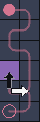
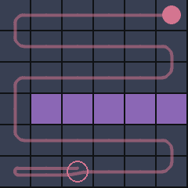
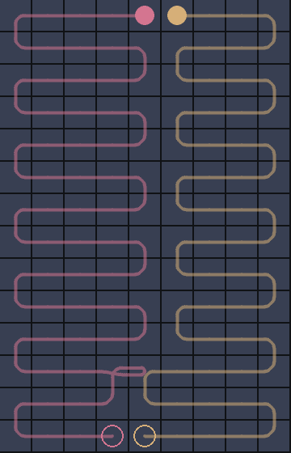

# PathPlanningSim

A grid sim for testing how several drones search a field together. Four drones sweep a 30 x 60 grid that has obstacles they can't see until they are one cell away.

```
python3 -m venv .venv && .venv/bin/python3 -m pip install -r requirements.txt
.venv/bin/python3 main.py         # visualizer
.venv/bin/python3 Sim.py          # headless run, prints ticks and coverage
.venv/bin/python3 edge_cases.py   # regenerates the screenshots below
```

In the visualizer, Space plays and pauses. The right arrow steps one tick and the left arrow steps back; hold either to repeat. The buttons along the bottom do the same, plus reset and randomize the obstacles. Esc quits. Three sliders control the obstacles:

- **obstacles** is the share of the field that is obstacles, 0 to 20%.
- **clustering** is how many times as likely a cell beside an existing obstacle is to become one. 1x is an even scatter, 3x is the default.
- **rounds** is how many rounds the obstacles are placed in. Clustering only applies from the second round on, so more rounds let clusters grow larger.

## How the path planning works

The field is cut into one vertical column per drone. Each drone sweeps its column with a boustrophedon ("bous") path: across a row, up one cell, across the next row. When a cell ahead turns out to be an obstacle, the drone drops it and runs A*, a shortest-path search, to the next cell it needs, routing around every obstacle any drone has seen so far. A detour often cuts through a neighbour's column, and the two drones settle each shared cell by who would reach it first.

- To pick where to go next, a drone looks at both ends of every unbroken run of unvisited cells in its column. Each end costs its A* steps plus 3 for every row it lies above the drone, and the cheapest wins. In open field that gives the usual sweep, started from whichever end of the row is nearer.
- Obstacle cells are removed from the sweep as they are seen. An obstacle seen by one drone is known to all four on the same tick.
- If the neighbour reaches a shared cell first, the detouring drone just flies through it.
- If both would reach it on the same tick, the neighbour flies as normal and the detouring drone waits one tick, then follows.
- If the neighbour would reach it later, the cell is reassigned to the detouring drone and comes off the neighbour's sweep.
- A drone has to fly over every cell it took, even when a later re-plan would bypass one. It visits them before going back to its own rows.
- A cell that A* can't reach is skipped for good.
- A drone never enters a cell that another drone is staying in or entering, and two drones never swap places.
- A drone making a single step along its sweep goes before a detouring one. Ties go to the lower drone index.
- Drones start side by side at the bottom centre. The walk to their own column never reassigns cells.
- Before moving up a row, a drone checks for cells it skipped lower down. If the shortest route to one runs only through cells already seen, and the trip is no longer than the rows it still has to climb, it goes back for it then instead of at the end.
- Every 5 ticks the work is shared out. If two neighbours' remaining work differs by more than 10 cells, the lighter one takes a one-cell strip of the other's column in the rows above them both.
- A drone that finishes takes over the cells the busiest drone would reach last, as many as it can finish by the time that drone is done. If nobody needs help it waits in its last cell.

## Parameters

Every number the planner depends on, all in `Planner` in `Pathing.py`, and where it came from. "Tuned" means chosen by measurement, "picked" means a reasonable value that was not tuned, and "derived" means it follows from something else. Measurements are on the 30 x 60 field with 4 drones, so re-measure if the grid or drone count changes much.

| Parameter | Value | What it does | Where the value comes from |
|---|---|---|---|
| `CLIMB_COST` | 3 | Extra cost, in steps, for each row a candidate cell lies above the drone. It makes a drone finish cells at or below its row before moving up, unless they are more than about 3 steps further away than the next row. | Tuned. Values 1 to 4 finished fastest and were within noise of each other; 6 and above were 3 to 5% slower at 8 to 20% obstacles. It is not scaled with column width. |
| `REROUTE_AFTER` | 2 ticks | How long a drone that must give way stays blocked behind another drone before it looks for a way round. | Picked. It is the "wait one tick, then go round" rule: one tick waiting, then act on the second. |
| `GIVE_UP_AFTER` | 8 ticks | How long a drone stays blocked with no way round before it skips the cell it was heading for. Also how long the drone with right of way holds its line in a head-on meeting. | Picked, not tuned. Long enough for another drone to clear a short corridor. |
| `STALL_FACTOR` | 3 | A drone that goes `STALL_FACTOR x (width + height)` ticks without ticking off a cell drops the one it is heading for. | Picked as a safety net. On the 30 x 60 field the limit is 270 ticks, far longer than any real detour. It has never triggered in testing. |
| Prediction horizon | length of the detour | How far ahead a neighbour's movements are played forward when deciding who reaches a shared cell first. | Derived. Anything the neighbour would reach later than the detouring drone counts as "later" anyway. |
| `BACKTRACK_WEIGHT` | 1.0 | A drone about to move up goes back for a skipped cell if the trip is at most this many times the rows it still has to climb. 0 switches the behaviour off. | Derived, then checked. Going back now costs about two trips; leaving the cell to the end costs about one trip plus the rows left to climb, so the break-even is 1. Measured: 0 was 4% slower on random maps and up to 10% on maps with a walled-off area; 0.5 to 2.5 were within noise of each other. |
| `REBALANCE_EVERY` | 5 ticks | How often work is shared out between drones. 0 switches sharing off. | Picked. 1, 5 and 15 finished within noise of each other. Sharing as a whole cut the time to finish by 8 to 9%. |
| `REBALANCE_GAP` | 10 cells | Two neighbours' remaining work must differ by more than this before a strip of cells moves between them. | Picked. 4, 10, 20 and 40 finished within noise of each other. |
| `HELP_MIN` | 6 cells | A finished drone only helps a drone with at least this many cells left. | Picked. 2, 6 and 20 finished within noise of each other. |
| Tie-breaks | left, lower index | Two equally cheap cells: the left one. Two drones with equal right of way: the lower index. | Picked, so that runs are repeatable. |

## Edge cases

Each picture is the drone view of a small map built to make one situation happen, after the run has finished. A ring marks where a drone started and a dot where it ended. Purple cells are obstacles. Where a drone flew between the same two cells more than once, the lines are drawn side by side. Drones are red, yellow, green and blue, from left to right.

To add a case, put its map in `CASES` in `edge_cases.py`, run the script, and describe it here. The maps are tuned to the planner as it stands, so after changing a planner rule or parameter, re-run the script and check each picture still shows what its entry says. Work sharing between drones is switched off in every picture except the two that are about it, so each shows one thing.

### A cell in the sweep is an obstacle



The drone is sweeping a two-wide column and the next cell up, on the left, turns out to be an obstacle.

It drops that cell and runs A* to the next one it needs, on the right of the same row. The shortest way there is back through the cell it just left, so the trail doubles up.

### A detour through a neighbour's column


An obstacle blocks yellow at the left edge of its column, and its detour crosses three cells of red's column. Red has already swept two of them and would not reach the third for a while.

Yellow flies straight through the two swept cells and nothing changes hands. The third is reassigned to yellow, which covers it on the way; red takes it off its own sweep and never visits it.

### Both drones due at a shared cell on the same tick


Green is crossing yellow's column to get round a cluster of obstacles, and would arrive at one of yellow's cells on the tick yellow is due there.

The cell stays yellow's and yellow flies as planned. Green waits one tick in the cell before it, then follows yellow through.

### A cell that cannot be reached


A free cell on the top row of yellow's column is shut in by three obstacles and the edge of the field.

A* finds no route to it, so yellow drops it for good and finishes without it. The cell is seen from next door but never flown over.

### Two drones meet head-on


An obstacle on the bottom row blocks blue's walk to its column, so it cuts through its neighbours' columns instead. Twice it comes face to face with another drone, each wanting the cell the other is in.

Drones never swap places. The planner spots each meeting before either drone moves, and the one without right of way, blue both times, re-plans around the other, so neither loses a tick.

### A gap one cell wide


The top row of yellow's column can only be reached through a single cell at the edge of red's column. Yellow goes in as red is coming out.

There is no way round. The drone without right of way, yellow, backs out one cell, red comes through, and yellow goes in after it.

### Boxed in at the start


Red's walk along the bottom row to its own column runs into a dead end, with obstacles ahead and above. The only way out is back through the cell yellow is about to move into.

Red has nowhere to step aside to, so yellow moves out of the way even though it has right of way. Red comes out and goes round, and yellow carries on.

### A finished drone parked in the way


Red finishes first and parks in its last cell, at the top of its column. Yellow's last cell is next door and can only be reached through the cell red is sitting in.

A finished drone with nobody to help stays put. One that blocks another drone steps aside to the nearest cell off that drone's route, here one cell to the left, and yellow finishes.

### The walk to the starting column


Drones start side by side in the middle of the bottom row, so the two outer ones cross a neighbour's column to reach their own.

That walk is transit only. The cells crossed stay with their owner, who still sweeps them, and the usual collision rules apply.

### Arriving at the far end of a row



A row of obstacles leaves one gap, at the left edge, so the drone comes up into the next row at its left end. A fixed left-right zigzag would have it start that row from the right.

The drone picks whichever end of a row is fewer A* steps away. It sweeps from the left and saves a crossing.

### A wall up the middle of a column


A wall of obstacles splits six rows of the drone's column into a left half and a right half. Taking rows strictly in order would mean flying round the end of the wall twice for every row.

Moving up a row costs 3 extra steps in the drone's scoring, far less than a trip round the wall. The drone starts up the right half, goes back for the left half after two rows while that is still a short trip, sweeps it to the top of the wall, crosses once, and finishes the right half.

### A walled-off area that gets skipped


An area on the left is walled off on its right and on top, so it can only be entered from below. The drone finishes a row on the far side of the wall and starts climbing there. Left alone, it would sweep to the top of the field and then fly all the way back down for the area.

Before each move up it checks the skipped cells. Here the known way back, round the foot of the wall, is 5 steps and nothing unseen could be shorter, with 12 rows still to climb, so it goes back after two rows. That saves 10 ticks on this map. Had an unseen cell offered a possible shortcut, it would have kept sweeping along the wall until that cell was seen.

### One drone has more to do than its neighbour



Yellow's column is one cell wider than red's, which leaves it 14 more cells to cover.

Neighbours compare their remaining work every 5 ticks. Red takes the nearest cell of yellow's column in every row above them both, twelve cells in all, so its rows are one cell wider from there up and the two finish closer together.

### A drone finishes early


Red's column is one cell narrower than yellow's, so red finishes while yellow still has most of its top row to do. (Boundary shifting is switched off for this picture.)

A finished drone takes over the cells the busiest drone would reach last, as many as it can finish by the time that drone is done. Red flies on into yellow's top row and takes four cells, and the two finish within two ticks of each other.

### Cases without a picture yet

- **A taken cell that a re-plan would bypass.** A drone that took a neighbour's cell for a detour keeps it as a required stop: if it has to re-plan, the new route still goes through that cell first. No small map shows this cleanly yet.
- **A drone that stops making progress.** A drone that goes 270 ticks (on this field) without ticking off a cell drops the one it is heading for and picks another, so one cell can never stall a run. It has not happened in testing.
