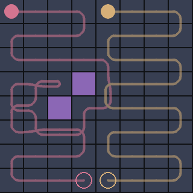
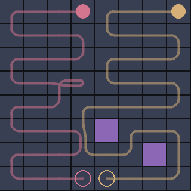
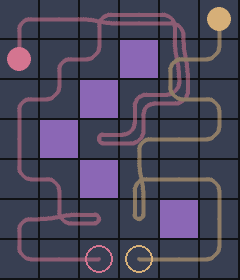
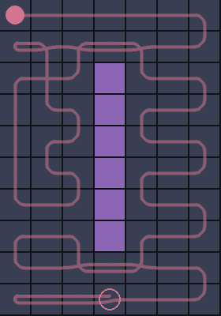

# PathPlanningSim

A grid sim for testing how several drones search a field together. Four drones sweep a 30 x 60 grid that has obstacles they can't see until they are one cell away.

```
python3 -m venv .venv && .venv/bin/python3 -m pip install -r requirements.txt
.venv/bin/python3 main.py         # visualizer
.venv/bin/python3 Sim.py          # headless run, prints ticks and coverage
.venv/bin/python3 edge_cases.py   # regenerates the screenshots below
```

In the visualizer, Space or the right arrow steps one tick and the left arrow steps back. Hold either to repeat. The buttons along the bottom play, pause, reset and randomize the obstacles. Esc quits. Three sliders control the obstacles:

- **obstacles** is the share of the field that is obstacles, 0 to 20%.
- **clustering** is how many times as likely a cell beside an existing obstacle is to become one. 1x is an even scatter, 3x is the default.
- **rounds** is how many rounds the obstacles are placed in. Clustering only applies from the second round on, so more rounds let clusters grow larger.

## How the path planning works

The field is cut into one vertical column per drone. Each drone sweeps its column with a boustrophedon ("bous") path: across a row, up one cell, across the next row. When a cell ahead turns out to be an obstacle, the drone drops it and runs A*, a shortest-path search, to the next cell it needs, routing around every obstacle any drone has seen so far. A detour often cuts through a neighbour's column, and the two drones settle each shared cell by who would reach it first.

- To pick where to go next, a drone looks at both ends of every unbroken run of unvisited cells in its column. Each end costs its A* steps plus 6 for every row it lies above the drone, and the cheapest wins. In open field that gives the usual sweep, started from whichever end of the row is nearer.
- Obstacle cells are removed from the sweep as they are seen. An obstacle seen by one drone is known to all four on the same tick.
- If the neighbour reaches a shared cell first, the detouring drone just flies through it.
- If both would reach it on the same tick, the neighbour flies as normal and the detouring drone waits one tick, then follows.
- If the neighbour would reach it later, the cell is reassigned to the detouring drone and comes off the neighbour's sweep.
- A drone has to fly over every cell it took, even when a later re-plan would bypass one. It visits them before going back to its own rows.
- A cell that A* can't reach is skipped for good.
- A drone never enters a cell that another drone is staying in or entering, and two drones never swap places.
- A drone making a single step along its sweep goes before a detouring one. Ties go to the lower drone index.
- Drones start side by side at the bottom centre. The walk to their own column never reassigns cells.
- A drone that finishes waits in its last cell until the others are done.

## Edge cases

Each picture is the drone view of a small map built to make one situation happen, after the run has finished. A ring marks where a drone started and a dot where it ended. Purple cells are obstacles. Where a drone flew between the same two cells more than once, the lines are drawn side by side.

To add a case, put its map in `CASES` in `edge_cases.py`, run the script, and describe it here.

### A cell in the sweep is an obstacle


The drone is sweeping a two-wide column and the next cell up, on the left, turns out to be an obstacle.

It drops that cell and runs A* to the next one it needs, on the right of the same row. The shortest way there is back through the cell it just left, so the trail doubles up.

### A detour through cells the neighbour has already swept



Two obstacles close off part of pink's column. The shortest way round runs through three cells of amber's column.

Amber had already flown over those cells, so nothing changes hands. Pink flies through them and carries on.

### A detour through a cell the neighbour has not reached yet



An obstacle blocks amber at the left edge of its column, and its detour crosses three cells of pink's column. Pink has swept two of them and would not reach the third for a while.

The third cell is reassigned to amber, which flies over it on the way. Pink takes it off its own sweep and never visits it.

### Both drones due at a shared cell on the same tick


Green is crossing amber's column to get round a cluster of obstacles, and would arrive at one of amber's cells on the tick amber is due there.

The cell stays amber's and amber flies as planned. Green waits one tick in the cell before it, then follows amber through.

### A taken cell that a re-plan would bypass



Pink took two cells in amber's column for a detour, then found that the first of them is an obstacle, which closes that route.

The other cell is still pink's to cover. Pink re-plans and reaches it the long way, across the top row, before going back to its own cells.

### A cell that cannot be reached


A free cell on the top row of amber's column is shut in by three obstacles and the edge of the field.

A* finds no route to it, so amber drops it for good and finishes without it. The cell is seen from next door but never flown over.

### Two drones meet head-on


Green took two cells at the top of cyan's column for a detour. On its way back down it meets cyan coming up, each wanting the cell the other is in.

Drones never swap places. The planner spots the meeting before either moves, and the drone without right of way, here cyan, re-plans around the other, so neither loses a tick.

### A gap one cell wide


The top row of amber's column can only be reached through a single cell at the edge of pink's column. Amber goes in as pink is coming out.

There is no way round. The drone without right of way, amber, backs out one cell, pink comes through, and amber goes in after it.

### Boxed in at the start


Pink's walk along the bottom row to its own column runs into a dead end, with obstacles ahead and above. The only way out is back through the cell amber is about to move into.

Pink has nowhere to step aside to, so amber moves out of the way even though it has right of way. Pink comes out and goes round, and amber carries on.

### A finished drone parked in the way


Pink finishes first and parks in its last cell, which amber has to pass through to reach the last cell of its own sweep.

A finished drone normally stays put. One that blocks another drone steps aside to the nearest cell off that drone's route, here one cell to the left, and amber finishes.

### The walk to the starting column


Drones start side by side in the middle of the bottom row, so the two outer ones cross a neighbour's column to reach their own.

That walk is transit only. The cells crossed stay with their owner, who still sweeps them, and the usual collision rules apply.

### Arriving at the far end of a row


A row of obstacles leaves one gap, at the left edge, so the drone comes up into the next row at its left end. A fixed left-right zigzag would have it start that row from the right.

The drone picks whichever end of a row is fewer A* steps away. It sweeps from the left and saves a crossing.

### A wall up the middle of a column



A wall of obstacles splits six rows of the drone's column into a left half and a right half. Taking rows strictly in order would mean flying round the end of the wall twice for every row.

Moving up a row costs 6 extra steps in the drone's scoring, which is less than a trip round the wall. So it sweeps the left half to the top of the wall, crosses once, sweeps the right half downwards, and then carries on above.

### A drone that stops making progress

No picture, because it has not happened in testing. A drone that goes 3 x (width + height) ticks without flying over a cell it wanted drops the cell it is heading for and picks another, so one cell can never stall a run.

## Obstacles

Obstacles are placed in rounds, three by default. The first round is uniformly random. In each later round, a free cell directly left, right, above or below an existing obstacle is `clustering` times as likely to be picked as any other cell, so obstacles form clusters.
