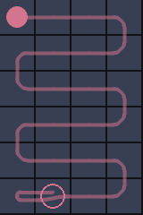
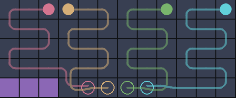
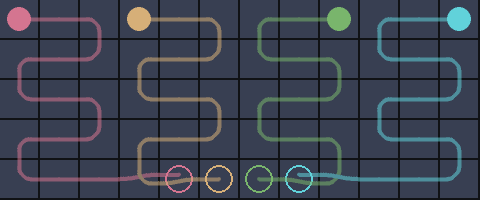
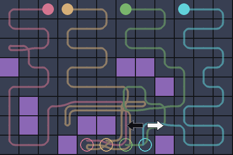
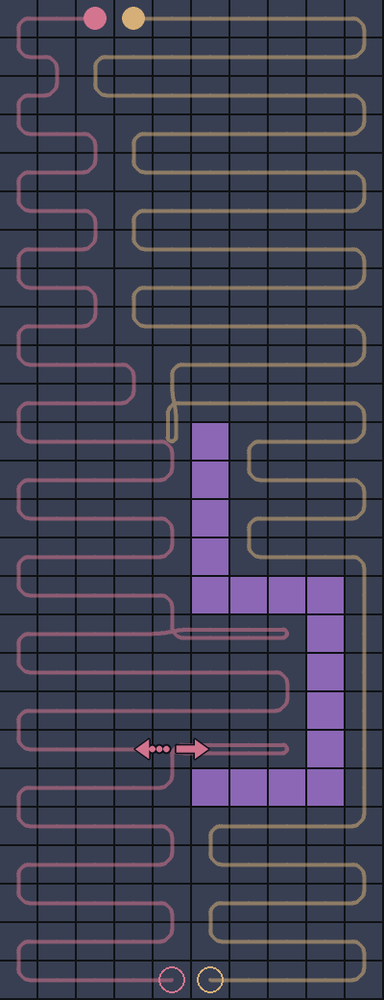

# PathPlanningSim

A grid sim for testing how several drones search a field together. Four drones sweep a 30 x 60 grid that has obstacles they can't see until they are one cell away.

## Edge cases

Click a group to open it. In each picture a solid arrow is the step the drone takes and a dotted arrow is the step it would have taken without the rule; a loop arrow means it waits in that cell.

<h3>One drone sweeping its column</h3>

<table>
<tr>
<td width="42%" align="center"></td>
<td>
<h4>The plain sweep</h4>

The field is cut into one vertical column per drone, and each drone sweeps its own: across a row, up one cell, back across the next. This is a boustrophedon path, "bous" for short.

No fixed path is stored. Each time it needs somewhere to go, the drone looks at both ends of every unbroken run of unvisited cells in its column. Each end costs the steps to reach it, found with A* (a shortest-path search), plus 3 for every row it lies above the drone, and the cheapest wins. On open ground that works out as this zigzag.

</td>
</tr>
<tr>
<td width="42%" align="center"></td>
<td>
<h4>A cell in the sweep is an obstacle</h4>

The drone is sweeping a two-wide column and the next cell up, on the left, turns out to be an obstacle.

It drops that cell and runs A* to the next one it needs, on the right of the same row. The shortest way there is back through the cell it just left, so the trail doubles up. Obstacles are shared: all four drones know about one from the tick any of them sees it, and route around it.

</td>
</tr>
<tr>
<td width="42%" align="center"></td>
<td>
<h4>Obstacles on the first row</h4>

Three obstacles fill the bottom row of red's column, so the first cells of its sweep do not exist.

The first row gets no special treatment. Red heads for the cheapest end of the first row it can reach, one row up, and starts sweeping there without waiting.

</td>
</tr>
<tr>
<td width="42%" align="center"></td>
<td>
<h4>A cell that cannot be reached</h4>

A free cell on the top row of yellow's column is shut in by three obstacles and the edge of the field.

A* finds no route to it, so yellow drops it for good and finishes without it. The cell is seen from next door but never flown over.

</td>
</tr>
<tr>
<td width="42%" align="center"></td>
<td>
<h4>Arriving at the far end of a row</h4>

A row of obstacles leaves one gap, at the left edge, so the drone comes up into the next row at its left end. A fixed left-right zigzag would have it start that row from the right.

The drone picks whichever end of a row is fewer A* steps away. It sweeps from the left and saves a crossing.

</td>
</tr>
<tr>
<td width="42%" align="center"></td>
<td>
<h4>A row cut in two by one obstacle</h4>

An obstacle splits a row into a single cell on the left and four cells on the right. The drone arrives on the left.

It flies the single cell, goes over the obstacle through the row above and drops back down to finish the right-hand part before carrying on upwards. A cell below the drone costs only its steps, while every row up costs 3 more, so a row is not left half done.

</td>
</tr>
<tr>
<td width="42%" align="center"></td>
<td>
<h4>A wall up the middle of a column</h4>

A wall of obstacles splits six rows of the drone's column into a left half and a right half. Taking rows strictly in order would mean flying round the end of the wall twice for every row.

Moving up a row costs 3 extra steps in the drone's scoring, far less than a trip round the wall. The drone starts up the right half, goes back for the left half after two rows while that is still a short trip, sweeps it to the top of the wall, crosses once, and finishes the right half. The arrows mark where it turns back.

</td>
</tr>
<tr>
<td width="42%" align="center"></td>
<td>
<h4>A detour over cells already flown</h4>

A two-cell wall splits two rows of the column. The drone has flown the three right-hand cells of the row below the wall and now has to go back left for the rest of that row, over the cells it just flew.

It steps up instead, flies the four cells to the right of the wall, and steps back down beside the wall: two extra steps for four new cells, which it then never has to come round the wall for. This map takes 69 ticks with the swap and 77 without. The swap needs at least 3 new cells to be worth its two steps; where the route was about to turn onto that row anyway it costs nothing, and one new cell is enough.

</td>
</tr>
<tr>
<td width="42%" align="center"></td>
<td>
<h4>A walled-off area that gets skipped</h4>

An area on the left is walled off on its right and on top, so it can only be entered from below. The drone finishes a row on the far side of the wall and starts climbing there. Left alone, it would sweep to the top of the field and then fly all the way back down for the area.

Before each move up it checks the skipped cells. Here the known way back, round the foot of the wall, is 5 steps and nothing unseen could be shorter, with 12 rows still to climb, so it goes back after two rows. That saves 10 ticks on this map. Had an unseen cell offered a possible shortcut, it would have kept sweeping along the wall until that cell was seen.

</td>
</tr>
<tr>
<td width="42%" align="center"></td>
<td>
<h4>A cell that takes too long to reach</h4>

For this picture the stall limit was cut from 51 ticks to 3. The drone sets off round the foot of the wall for a cell on the other side, and the trip is longer than that.

After 4 ticks without flying over a new cell it drops the cell it was heading for and picks the next one, which leaves one cell unflown. At the real limit, 270 ticks on the full field, this has never happened in testing. It is there so that one cell can never hold up a run.

</td>
</tr>
</table>

<h3>Crossing a neighbour's column</h3>

<table>
<tr>
<td width="42%" align="center"></td>
<td>
<h4>The walk to the starting column</h4>

Drones start side by side in the middle of the bottom row, so the two outer ones cross a neighbour's column to reach their own.

That walk is transit only. The cells crossed stay with their owner, who still sweeps them, and the usual collision rules apply.

</td>
</tr>
<tr>
<td width="42%" align="center"></td>
<td>
<h4>A detour through a neighbour's column</h4>

An obstacle blocks yellow at the left edge of its column, and its detour crosses three cells of red's column. Red has already swept two of them and would not reach the third for a while.

Yellow flies straight through the two swept cells and nothing changes hands. The third is reassigned to yellow, which covers it on the way; red takes it off its own sweep and never visits it.

</td>
</tr>
<tr>
<td width="42%" align="center"></td>
<td>
<h4>Both drones due at a shared cell on the same tick</h4>

Yellow is crossing green's column to get round obstacles, and would arrive at one of green's cells on the tick green is due there.

The cell stays green's and green flies as planned. A drone making a single step along its sweep goes before one on a detour, so yellow waits one tick in the cell before it, then follows green through. The loop arrow marks where it waits.

</td>
</tr>
<tr>
<td width="42%" align="center"></td>
<td>
<h4>A taken cell that a re-plan would bypass</h4>

Green's way up is walled off, so it plans a detour through yellow's column and takes two of yellow's top-row cells that the route crosses. One of them turns out to be an obstacle, which kills the detour, and green has to go the long way round its own side.

The other taken cell is no longer on the way to anything, but yellow has dropped it. Green keeps it as a required stop: it comes round, steps one cell out along the top row to fly over it, and comes back.

</td>
</tr>
<tr>
<td width="42%" align="center"></td>
<td>
<h4>New eyes over the same eyes</h4>

Red has flown into a one-cell pocket and heads for its next row, three rows up. Two routes are equally short. One runs over a cell only red has flown; the other over a cell on the edge of yellow's column that only yellow has flown.

Red takes the one through yellow's cell, which gives that cell a second look, where re-flying its own cell would add nothing. This only settles ties between equally short routes and never makes a route longer.

</td>
</tr>
</table>

<h3>Drones in each other's way</h3>

<table>
<tr>
<td width="42%" align="center"></td>
<td>
<h4>Two drones meet head-on</h4>

Red's last cell is cut off from the rest of its column by obstacles, so red comes down the edge of yellow's column to reach it, just as yellow is coming up that edge. They are face to face, each wanting the cell the other is in.

Drones never swap places. The planner spots the meeting before either drone moves. Both are on detours, so the lower index, red, has right of way, and yellow re-plans through the next cell over. Neither loses a tick.

</td>
</tr>
<tr>
<td width="42%" align="center"></td>
<td>
<h4>A gap one cell wide</h4>

The top row of yellow's column can only be reached through a single cell at the edge of red's column. Yellow goes in as red is coming out.

There is no way round. The drone without right of way, yellow, backs out one cell, red comes through, and yellow goes in after it.

</td>
</tr>
<tr>
<td width="42%" align="center"></td>
<td>
<h4>Boxed in at the start</h4>

Red's walk along the bottom row to its own column runs into a dead end, with obstacles ahead and above. The only way out is back through the cell yellow is about to move into.

Red has nowhere to step aside to, so yellow moves out of the way even though it has right of way. Red comes out and goes round, and yellow carries on.

</td>
</tr>
<tr>
<td width="42%" align="center"></td>
<td>
<h4>Stuck behind a drone that is not moving</h4>

Blue is cutting through the middle of the field to get round obstacles on its walk out. The cell ahead holds green, which is itself held up by yellow.

Blue waits one tick in case the way clears. Green is still there, so on the next tick blue plans a route around the cell green is in and carries on.

</td>
</tr>
<tr>
<td width="42%" align="center"></td>
<td>
<h4>The next cell has another drone in it</h4>

Green's next cell is one step away, but yellow and then red pass through it on their way round an obstacle.

Green waits a tick, then drops the cell instead of queueing for it, since a drone is flying over it anyway. Green carries on with its sweep and never goes back for that cell.

</td>
</tr>
<tr>
<td width="42%" align="center"></td>
<td>
<h4>A finished drone parked in the way</h4>

Red finishes first and parks in its last cell, at the top of its column. Yellow's last cell is behind two obstacles, and the only way to it starts with the cell red is sitting in.

A finished drone with nobody to help stays put. Once yellow has waited two ticks behind it, red steps aside to the nearest cell off yellow's route, one cell to the left, and yellow goes through and finishes.

</td>
</tr>
</table>

<h3>Sharing the work</h3>

<table>
<tr>
<td width="42%" align="center"></td>
<td>
<h4>One drone has more to do than its neighbour</h4>

Yellow's column is one cell wider than red's, which leaves it 14 more cells to cover.

Neighbours compare their remaining work every tick. Red takes half the difference, seven cells: the nearest cell of yellow's column in each of the top seven rows. Its rows are one cell wider from there up, and the two finish on the same tick. When cells move again later, they come first from the rows where the boundary has moved least from the original split, so it stays straight.

</td>
</tr>
<tr>
<td width="42%" align="center"></td>
<td>
<h4>A drone finishes early</h4>

Red's column is one cell narrower than yellow's, so red finishes while yellow still has most of its top row to do. Boundary shifting is switched off for this picture.

A finished drone takes over the cells the busiest drone would reach last, as many as it can finish by the time that drone is done. Red flies on into yellow's top row and takes four cells, and the two finish within two ticks of each other.

</td>
</tr>
<tr>
<td width="42%" align="center"></td>
<td>
<h4>Cells walled off from their own drone</h4>

A pocket in yellow's column is closed on the top, right and bottom and opens only towards red's column, and a short wall runs up the boundary above it. Yellow climbs past on the far side, and left alone would fly all the way back round for it at the end.

Each time yellow is about to move up, any drone closer to the cells it is leaving behind takes them. Red is beside the opening, so the pocket's rows join red's sweep. Red then has more to do, so the boundary shift gives yellow cells from the edge of red's column in the rows above the wall. The run takes 125 ticks instead of 138.

</td>
</tr>
</table>

## Parameters

Every number the planner depends on, all in `Planner` in `Pathing.py`, and where it came from. "Tuned" means chosen by measurement, "picked" means a reasonable value that was not tuned, and "derived" means it follows from something else. Measurements are on the 30 x 60 field with 4 drones, so re-measure if the grid or drone count changes much.

| Parameter | Value | What it does | Where the value comes from |
|---|---|---|---|
| `CLIMB_COST` | 3 | Extra cost, in steps, for each row a candidate cell lies above the drone. It makes a drone finish cells at or below its row before moving up, unless they are more than about 3 steps further away than the next row. | Tuned. Values 1 to 4 finished fastest and were within noise of each other; 6 and above were 3 to 5% slower at 8 to 20% obstacles. It is not scaled with column width. |
| `REROUTE_AFTER` | 2 ticks | How long a drone that must give way stays blocked behind another drone before it looks for a way round. | Picked. It is the "wait one tick, then go round" rule: one tick waiting, then act on the second. |
| `GIVE_UP_AFTER` | 8 ticks | How long a drone stays blocked with no way round before it skips the cell it was heading for. Also how long the drone with right of way holds its line in a head-on meeting. | Picked, not tuned. Long enough for another drone to clear a short corridor. |
| `STALL_FACTOR` | 3 | A drone that goes `STALL_FACTOR x (width + height)` ticks without ticking off a cell drops the one it is heading for. | Picked as a safety net. On the 30 x 60 field the limit is 270 ticks, far longer than any real detour. It has never triggered in testing. |
| Prediction horizon | length of the detour | How far ahead a neighbour's movements are played forward when deciding who reaches a shared cell first. | Derived. Anything the neighbour would reach later than the detouring drone counts as "later" anyway. |
| `BACKTRACK_WEIGHT` | 1.0 | A drone about to move up goes back for a skipped cell if the trip is at most this many times the rows it still has to climb. 0 switches the behaviour off. | Derived, then checked. Going back now costs about two trips; leaving the cell to the end costs about one trip plus the rows left to climb, so the break-even is 1. Measured: 0 was 4% slower on random maps and up to 10% on maps with a walled-off area; 0.5 to 2.5 were within noise of each other. |
| `REBALANCE_EVERY` | 1 tick | How often work is shared out between drones. 0 switches sharing off. | Chosen for consistency with the rest of the planner, which re-plans every tick. It does not matter for speed: intervals of 1, 2, 5, 10, 20 and 50 ticks finished within noise of each other on five kinds of map (30 maps each), and switching sharing off was 3 to 5% slower. |
| `REBALANCE_GAP` | 1 cell | Two neighbours' remaining work must differ by more than this before cells move between them. Half the difference moves. | Chosen to keep the loads as even as possible, against the measurement. Thresholds of 1, 4 and 10 finished default maps in 488, 484 and 483 ticks on average (30 maps), and dense maps in 527, 523 and 516. At 1, cells change hands about 400 times a run on a default map; at 10, about 17. |
| `HELP_MIN` | 6 cells | A finished drone only helps a drone with at least this many cells left. | Picked. 2, 6 and 20 finished within noise of each other. |
| `HANDOVER_WEIGHT` | 1.0 | Cells a drone is leaving behind go to another drone if that drone's trip to them, times this, is shorter than the owner's. 0 switches handing over off. | Picked as the plain comparison, then checked. 0.75, 1, 1.5 and 2 finished default maps within a tick of each other. Switching it off makes no difference on default maps and is 1.6% slower on dense, clustered maps and 3% slower on very dense ones. |
| `SIDE_ROW_MIN` | 3 cells | A sideways stretch of a detour over already-flown cells moves to the row above or below, for two extra steps, if that covers at least this many of the drone's unvisited cells. 0 switches it off. | Tuned. Off, 2, 3, 4 and 6 finished default maps in 488, 480, 476, 477 and 487 ticks on average (30 maps) and sparse maps in 478, 474, 467, 469 and 476. The open field is 2 ticks slower with it on (455 against 453). Where the route turns onto that row anyway the swap is free and one new cell is enough; asking for 3 there as well was 2 ticks slower on default maps. |
| Boundary shift order | least shifted row, then furthest up | Which cells move when neighbours even out their work: one per row, from the rows where the boundary is closest to the original split. | Measured against taking the top row first, which hollowed out the top rows into long sideways slivers. Default maps went from 476 to 468 ticks on average (30 maps), sparse from 467 to 461, dense from 520 to 508. |
| Tie-breaks | new eyes, left, lower index | Two equally short routes: the one over more cells that only other drones have flown. Two equally cheap cells: the left one. Two drones with equal right of way: the lower index. | Picked. The first gives a cell a second look for free; the others make runs repeatable. |
